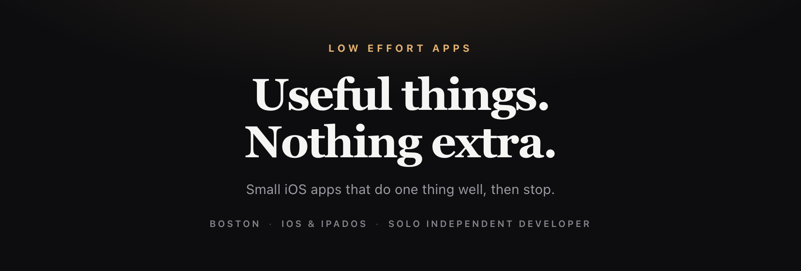

<picture>
  <source media="(prefers-color-scheme: light)" srcset="docs/hero-light.png">
  
</picture>

<code>iOS</code> · <code>iPadOS</code> · <code>Swift / SwiftUI</code> · <code>no accounts</code> · <code>no subscriptions</code>

  

---

Solo indie developer in Boston. I work a day job and build iOS apps on the side — using AI as an engineering partner, not a magic button.

Every app follows one rule: **do one thing well, then stop.** Native SwiftUI, local-first by default, free or one-time purchase. No accounts, no analytics, no subscriptions extracting value month after month.

### The apps

<!-- bento:start -->

<!-- bento:end -->

### How I build

- **One job per app.** If it needs a tour of the settings screen, it's two apps.
- **Local-first.** Your data lives on your device and in your iCloud. No analytics, no tracking SDKs, no third-party dependencies.
- **No subscriptions.** Free, or buy once and own it.
- **Small and finished.** Shipping beats a roadmap.

### Stack

`Swift / SwiftUI` · `SwiftData + CloudKit` · `WidgetKit` · `App Intents` · `StoreKit 2` · `TypeScript` for the web bits

### Find me

[loweffortapps.app](https://www.loweffortapps.app) · [Threads](https://www.threads.com/@mrjeffwithag) · [Bluesky](https://bsky.app/profile/loweffortgeoff.bsky.social) · `geoff_silva@loweffortapps.dev`

 If one of these saves you a minute, an App Store review means a lot.

